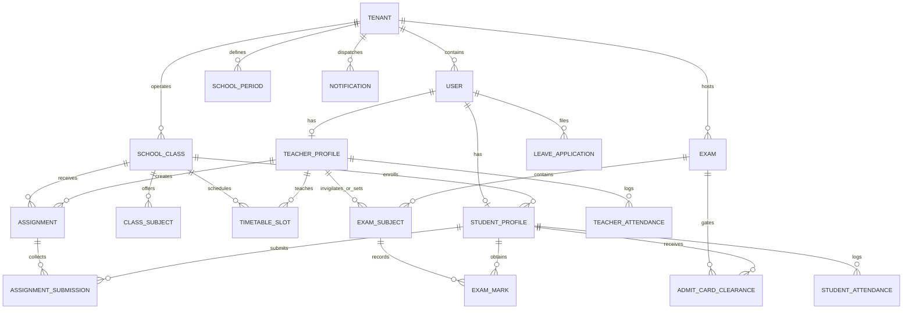
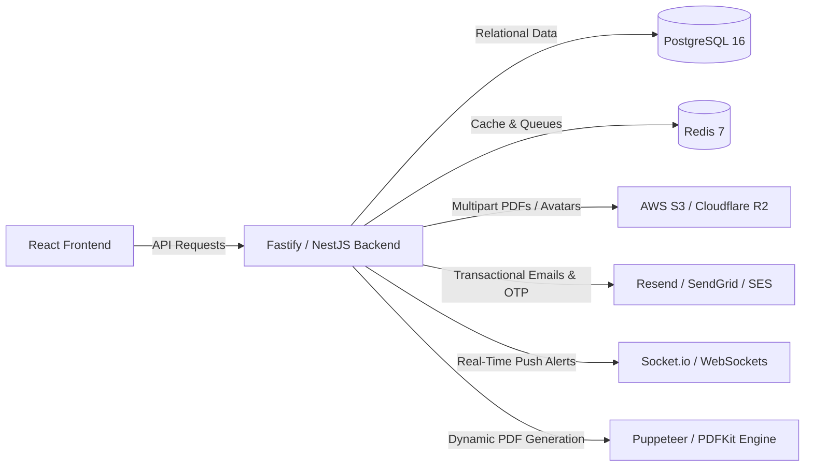
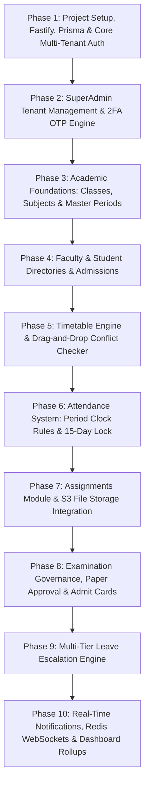

# 🏫 DigiSchool ERP — Complete System Architecture & Backend Requirements Analysis Report

**Document Title:** Enterprise Backend Architecture & Frontend Dependency Analysis Report  
**Project Name:** DigiSchool ERP  
**Author / Role:** Senior Software Architect & Backend Engineering Lead  
**Frontend Stack:** React 19, TypeScript ~6.0, Vite 8, Tailwind CSS, TanStack Query, Zustand, React Hook Form, Zod  
**Target Backend:** Multi-Tenant Enterprise Educational Operating System  
**Version:** 1.0.0 (Production Blueprint)  
**Date:** March 2025  

---

## Executive Summary

**DigiSchool ERP** is not a standard CRUD administration dashboard. It is an **Intelligent, Workflow-Driven, Multi-Tenant Educational Operating System** designed to connect and synchronize operations across multiple organizational hierarchies:
1. **Super Administrator** (Platform SaaS owner, school onboarding, tenant lifecycle management, 2FA security).
2. **School Manager / Principal** (Institutional tenant administrator, faculty management, student lifecycle, academic calendars, timetable scheduling, exam governance, leave approvals).
3. **Teacher / Faculty** (Classroom operations, timetable synchronization, real-time period attendance with a 15-day historical lock, homework/assignment publishing, digital paper submission, student grading, leave requests).
4. **Student** (Class schedules, personal subject-wise attendance analytics, homework submissions via digital attachments, exam timetable view, admit card downloads conditional upon fee/attendance clearances, leave applications).
5. **Parent** (Child progress tracking, fee statements, attendance monitoring — planned architecture).

The frontend is completely built in **React 19 + TypeScript**, utilizing **Zustand** and `localStorage` for simulated client-side persistence and mock authentication. This report provides a complete, exhaustive, component-by-component architectural blueprint for engineering a **high-performance, secure, ACID-compliant, scalable backend**.

---

## Table of Contents
1. [Project Overview](#1-project-overview)
2. [Existing Technology Stack](#2-existing-technology-stack)
3. [Complete Folder Architecture](#3-complete-folder-architecture)
4. [Page-by-Page Analysis](#4-page-by-page-analysis)
5. [Component-Level Functionality Analysis](#5-component-level-functionality-analysis)
6. [Complete Feature Inventory](#6-complete-feature-inventory)
7. [Static Data vs Dynamic Data Identification](#7-static-data-vs-dynamic-data-identification)
8. [Frontend-to-Backend Dependency Mapping](#8-frontend-to-backend-dependency-mapping)
9. [Database Entity Requirements](#9-database-entity-requirements)
10. [Required API Endpoint Planning](#10-required-api-endpoint-planning)
11. [Authentication and Authorization Requirements](#11-authentication-and-authorization-requirements)
12. [Third-Party Integration Requirements](#12-third-party-integration-requirements)
13. [Performance and Scalability Analysis](#13-performance-and-scalability-analysis)
14. [Security Requirements](#14-security-requirements)
15. [Recommended Backend Technology Stack](#15-recommended-backend-technology-stack)
16. [Architecture Recommendation](#16-architecture-recommendation)
17. [Potential Technical Risks](#17-potential-technical-risks)
18. [Unclear Requirements and Engineering Assumptions](#18-unclear-requirements-and-engineering-assumptions)
19. [Recommended Backend Development Roadmap](#19-recommended-backend-development-roadmap)

---

## 1. Project Overview

### 1.1 System Purpose
DigiSchool ERP automates educational operations by replacing manual, fragmented workflows with unified digital pipelines. Unlike generic school management tools, DigiSchool features tightly coupled inter-module workflows:
- **Onboarding Pipeline:** SuperAdmin creates a School tenant $\rightarrow$ Manager account auto-generated with mandatory temporary credentials $\rightarrow$ Manager forced to reset password on first login $\rightarrow$ Celebratory onboarding trigger $\rightarrow$ Manager configures classes, subjects, and periods.
- **Academic Deployment Pipeline:** Manager creates classes and maps curriculum subjects $\rightarrow$ Manager creates Teachers with initial credentials $\rightarrow$ Manager assigns timetable slots and class coordinators $\rightarrow$ Teacher's dashboard dynamically populates with today's teaching agenda based on real-time period clocks.
- **Attendance & Compliance Pipeline:** Teachers mark attendance during an active class period (minimum 5 minutes elapsed rule) $\rightarrow$ Aggregates feed directly into student attendance averages $\rightarrow$ Attendance directly governs Admit Card generation eligibility.
- **Examination Governance Pipeline:** Manager creates multi-class exam schedules $\rightarrow$ Teachers receive paper preparation tasks $\rightarrow$ Teachers upload question papers (PDF) $\rightarrow$ Manager reviews and approves/rejects papers $\rightarrow$ Teachers upload marks $\rightarrow$ Manager approves admit cards based on fee dues and attendance $\rightarrow$ Students download admit cards.
- **Leave Escalation Pipeline:** Student submits leave $\rightarrow$ Routes to Class Teacher (`PENDING_TEACHER`) $\rightarrow$ Teacher approves/forwards to Manager (`PENDING_MANAGER`) $\rightarrow$ Manager grants final approval. Teacher leaves route directly to Manager.

### 1.2 Multi-Tenancy Architecture
The application is strictly **multi-tenant**. Every core entity belongs to a `schoolId`. A special global guard, `InactiveSchoolGuard`, monitors the tenant's subscription status (`ACTIVE` vs `INACTIVE`). If `INACTIVE`, all dashboard interactions are blurred and disabled, rendering a full-screen "Subscription Ended" state.

---

## 2. Existing Technology Stack

| Layer | Technology | Version | Purpose in Codebase |
| :--- | :--- | :--- | :--- |
| **Runtime & Bundler** | Vite | `^8.0.12` | Modern ESM development server and production bundler |
| **Language** | TypeScript | `~6.0.2` | Strict type definitions, interfaces, and compile-time safety |
| **UI Framework** | React | `^19.2.6` | Component rendering, concurrent features, modern hooks |
| **DOM Renderer** | React DOM | `^19.2.6` | Client DOM manipulation |
| **Routing** | React Router DOM | `^7.15.1` | Declarative client-side routing, route guards, navigation |
| **Styling** | Tailwind CSS | `^3.4.3` | Utility-first responsive CSS styling with dark mode support |
| **Icons** | Lucide React | `^1.16.0` | Comprehensive iconography system across the UI |
| **State Management** | Zustand | `^5.0.13` | Lightweight global stores for Auth and Notification state |
| **Server State** | TanStack React Query | `^5.100.14` | Async data caching, background refetching, query keys |
| **Data Tables** | TanStack React Table | `^8.21.3` | Headless table logic: pagination, multi-sort, column filtering |
| **Form Handling** | React Hook Form | `^7.76.1` | Uncontrolled high-performance form state management |
| **Schema Validation** | Zod | `^4.4.3` | Runtime schema parsing, form input validation, payload types |
| **HTTP Client** | Axios | `^1.16.1` | Base HTTP client (`apiClient`), currently with dummy config |
| **Date Utilities** | Day.js | `^1.11.20` | Date manipulation and formatting |
| **Toast Alerts** | Sonner | `^2.0.7` | Rich, non-blocking toast notifications with styling |
| **Analytics Charts** | Recharts | `^3.8.1` | Responsive SVG charts (Attendance bar charts, trends) |
| **Deployment** | Render Static Site | N/A | `render.yaml` static publishing with SPA rewrite rules |

---

## 3. Complete Folder Architecture

```
DigiSchool/
├── PROJECT_ANALYSIS_REPORT.md            # Comprehensive Backend Analysis Report (This Document)
├── README.md                             # Repository Overview
└── frontend/
    ├── .env.sample                       # Sample environment variable: VITE_API_BASE_URL
    ├── .gitignore                        # Git exclusion rules
    ├── eslint.config.js                  # ESLint configuration
    ├── index.html                        # Single Page Application HTML root
    ├── package.json                      # Frontend dependencies and npm scripts
    ├── package-lock.json                 # Dependency lock file
    ├── postcss.config.js                 # PostCSS setup for Tailwind CSS
    ├── PROGRESS.md                       # Roadmap & completed milestones document
    ├── render.yaml                       # Cloud deployment configuration for Render
    ├── tailwind.config.ts                # Tailwind design tokens, colors, dark mode setup
    ├── tsconfig.app.json                 # TypeScript app compilation options
    ├── tsconfig.json                     # TypeScript project root configuration
    ├── tsconfig.node.json                # TypeScript node configuration
    ├── vite.config.ts                    # Vite config with '@' alias pointing to ./src
    ├── public/
    │   ├── _redirects                    # SPA redirect configuration for netlify/render
    │   ├── favicon.svg                   # Browser favicon
    │   ├── icons.svg                     # Vector asset library
    │   └── mock/
    │       └── users.json                # Seed SuperAdmin credential mock file
    └── src/
        ├── main.tsx                      # App entry point, DOM mount, Theme & Auth wrappers
        ├── vite-env.d.ts                 # Vite client type references
        ├── app/
        │   ├── App.tsx                   # Top-level component rendering Router & Sonner Toaster
        │   ├── guards/
        │   │   └── InactiveSchoolGuard.tsx # Multi-tenant subscription overlay guard
        │   ├── providers/
        │   │   ├── AppProviders.tsx      # Composed providers wrapper
        │   │   ├── QueryProvider.tsx     # TanStack React Query client provider
        │   │   └── RouterProvider.tsx    # Router provider placeholder
        │   └── router/
        │       ├── AppRouter.tsx         # Central application routing table and role routing
        │       ├── ProtectedRoute.tsx    # Authentication & mandatory password change guard
        │       ├── PublicRoute.tsx       # Guest access route wrapper
        │       ├── RoleGuard.tsx         # RBAC route authorization guard
        │       └── routePaths.ts         # Centralized path constants
        ├── assets/                       # Static SVGs, images, and branding assets
        ├── components/
        │   ├── guards/                   # Reusable UI guard components
        │   ├── shared/
        │   │   ├── PageHeader.tsx        # Standardized page title, subtitle, and action buttons
        │   │   ├── SearchBar.tsx         # Global search input with clear icon
        │   │   ├── StatCard.tsx          # Stat metric card with trend indicators
        │   │   └── TableToolbar.tsx      # Table utility bar (search, export, bulk delete)
        │   └── ui/
        │       ├── ActionButton.tsx      # Icon action trigger button
        │       ├── Button.tsx            # Styled polymorphic button with variants & loading state
        │       ├── ColumnVisibilityDropdown.tsx # Headless table column visibility picker
        │       ├── ConfirmModal.tsx      # Two-step danger confirmation dialog
        │       ├── DataTable.tsx         # Enterprise table component with sorting & selection
        │       ├── EmptyState.tsx        # Zero-data display with call-to-action
        │       ├── FormError.tsx         # Zod validation error message badge
        │       ├── FormSection.tsx       # Form input group container
        │       ├── Input.tsx             # Text, email, password, and number form inputs
        │       ├── Modal.tsx             # Accessible backdrop modal dialog
        │       ├── ModalAction.tsx       # Modal footer action bar
        │       ├── Pagination.tsx        # Page number and navigation controller
        │       ├── RowsPerPageSelect.tsx # Page size selector dropdown
        │       ├── StatusBadge.tsx       # Pill badges for ACTIVE, INACTIVE, PRESENT, etc.
        │       └── TableSkeleton.tsx     # Animated shimmer loading skeleton for tables
        ├── config/
        │   ├── permissions.ts            # Granular permission definitions per role
        │   └── sidebarConfig.ts          # Role-based sidebar navigation schema
        ├── constants/
        │   ├── emptyStates.ts            # Default text for empty states
        │   ├── localStorageKeys.ts       # Keys used for browser mock persistence
        │   ├── queryKeys.ts              # TanStack Query cache keys
        │   └── roles.ts                  # UserRole enum constants (SUPER_ADMIN, MANAGER, etc.)
        ├── context/
        │   ├── AuthContext.tsx           # React context wrapping Zustand Auth store
        │   ├── NotificationContext.tsx   # React context for notifications
        │   └── ThemeContext.tsx          # Light/Dark mode state and DOM class manager
        ├── features/
        │   ├── assignments/              # Homework & assignment workflow module
        │   │   ├── components/
        │   │   │   └── ManagerAssignments.tsx # School-wide assignment oversight for Managers
        │   │   ├── pages/
        │   │   │   ├── AssignmentsPage.tsx # Route dispatcher based on user role
        │   │   │   ├── StudentAssignmentsPage.tsx # Homework submission & grade review
        │   │   │   └── TeacherAssignmentsPage.tsx # Homework publishing & grading portal
        │   │   ├── services/
        │   │   │   └── assignment.service.ts # Assignment and submission CRUD service
        │   │   └── types/
        │   │       └── assignment.types.ts # Assignment, Submission, and Status models
        │   ├── attendance/               # Attendance module
        │   │   ├── pages/
        │   │   │   ├── StudentAttendancePage.tsx # Student calendar, % stats & subject breakdowns
        │   │   │   └── TeacherAttendancePage.tsx # Period attendance with 15-day edit lock
        │   │   ├── services/
        │   │   │   └── attendance.service.ts # Student & faculty attendance service
        │   │   └── types/
        │   │       └── attendance.types.ts # Attendance status and record models
        │   ├── auth/                     # Authentication & authorization module
        │   │   ├── pages/
        │   │   │   ├── ChangePasswordPage.tsx # Mandatory first-login password reset page
        │   │   │   └── LoginPage.tsx     # Universal login portal for all roles
        │   │   ├── schemas/
        │   │   │   └── loginSchema.ts    # Zod login schema
        │   │   ├── services/
        │   │   │   └── auth.service.ts   # Mock authentication service
        │   │   ├── store/
        │   │   │   └── authStore.ts      # Zustand auth state with localStorage sync
        │   │   └── types/
        │   │       └── auth.types.ts     # User, LoginPayload, and AuthResponse models
        │   ├── dashboard/                # Role-specific analytics and overview module
        │   │   ├── components/
        │   │   │   ├── ActivityCard.tsx  # Timeline item component
        │   │   │   ├── AttendanceChart.tsx # Recharts interactive attendance graph
        │   │   │   ├── DashboardCard.tsx # Container card component
        │   │   │   ├── DashboardHeader.tsx # Header with user welcome & dates
        │   │   │   ├── DashboardSection.tsx # Section layout wrapper
        │   │   │   ├── DashboardSkeleton.tsx # Shimmer skeleton loader
        │   │   │   ├── DashboardStats.tsx # Grid of top metric counters
        │   │   │   ├── EmptyDashboardState.tsx # Fallback empty view
        │   │   │   ├── FirstLoginCongrats.tsx # Confetti celebratory modal for new users
        │   │   │   ├── QuickActionButton.tsx # Fast action button
        │   │   │   ├── QuickActions.tsx  # Quick link grid for Managers
        │   │   │   ├── RecentActivities.tsx # Live audit feed component
        │   │   │   ├── RevenuePlaceholder.tsx # Financial revenue placeholder component
        │   │   │   ├── TeacherPendingTasks.tsx # Urgent tasks card for Teachers
        │   │   │   └── TeacherQuickActions.tsx # Quick link grid for Teachers
        │   │   ├── constants/
        │   │   │   └── dashboardData.ts  # Fallback default statistics
        │   │   ├── hooks/
        │   │   │   └── useDashboard.ts   # Data aggregation hook
        │   │   ├── pages/
        │   │   │   └── DashboardPage.tsx # Central dashboard routing component
        │   │   ├── sections/
        │   │   │   ├── ManagerDashboard.tsx # Manager executive dashboard
        │   │   │   ├── StudentDashboard.tsx # Student academic dashboard
        │   │   │   ├── SuperAdminDashboard.tsx # SaaS tenant health dashboard
        │   │   │   └── TeacherDashboard.tsx # Daily teaching schedule & attendance dashboard
        │   │   ├── services/
        │   │   │   └── dashboard.service.ts # Aggregation service computing real metrics
        │   │   └── types/
        │   │       └── dashboard.types.ts # Dashboard stat and chart models
        │   ├── exams/                    # Examination lifecycle module
        │   │   ├── components/
        │   │   │   └── ScheduleExamModal.tsx # Fast exam scheduling modal
        │   │   ├── pages/
        │   │   │   ├── ExamsRouterPage.tsx # Role dispatcher for exam routes
        │   │   │   ├── ManagerExamsPage.tsx # Paper approval, admit approval & exam schedules
        │   │   │   ├── ScheduleExamPage.tsx # Step-by-step multi-class exam scheduler
        │   │   │   ├── StudentExamsPage.tsx # Exam timetable & admit card downloader
        │   │   │   └── TeacherExamsPage.tsx # Paper uploader & student marks grading
        │   │   ├── services/
        │   │   │   └── exam.service.ts   # Exam schedules, admit cards, and paper approval service
        │   │   └── types/
        │   │       └── exam.types.ts     # Exam, Subject, PaperStatus, AdmitCard models
        │   ├── leave/                    # Leave request & multi-level approval module
        │   │   ├── pages/
        │   │   │   ├── LeaveRouterPage.tsx # Role dispatcher for leave routes
        │   │   │   ├── ManagerLeavePage.tsx # Final approval portal for all school leaves
        │   │   │   ├── StudentLeavePage.tsx # Student application submission & tracking
        │   │   │   └── TeacherLeavePage.tsx # Teacher application & student triage
        │   │   ├── services/
        │   │   │   └── leave.service.ts  # Leave application and status update service
        │   │   └── types/
        │   │       └── leave.types.ts    # LeaveApplication and LeaveStatus models
        │   ├── notification/             # Notification state & full page view
        │   │   ├── pages/
        │   │   │   └── NotificationsPage.tsx # Full-screen notification inbox with filtering
        │   │   └── store/
        │   │       └── notificationStore.ts # Red-dot unread tracking Zustand store
        │   ├── notifications/            # Floating notification UI components
        │   │   └── components/
        │   │       ├── NotificationBadge.tsx # Red-dot indicator for sidebar items
        │   │       └── NotificationBell.tsx # Top navbar dropdown bell with unread count
        │   ├── profile/                  # User self-service profile management
        │   │   └── pages/
        │   │       └── ProfilePage.tsx   # Edit contact, family, qualification, avatar
        │   ├── student/                  # Student directory & class curriculum module
        │   │   ├── components/
        │   │   │   ├── ActiveFilterChips.tsx # Filter pills with one-click dismiss
        │   │   │   ├── ClassSubjectsSection.tsx # Class creation & subject allocation UI
        │   │   │   ├── StudentActionCell.tsx # Row action menu (Edit, View, Delete)
        │   │   │   ├── StudentBottomDrawer.tsx # Mobile detail drawer
        │   │   │   ├── StudentDetails.tsx # Tabbed student profile view
        │   │   │   ├── StudentDetailsDrawer.tsx # Desktop slide-over drawer
        │   │   │   ├── StudentExpandableCard.tsx # Mobile expandable list item
        │   │   │   ├── StudentFilters.tsx # Multi-attribute filter dropdowns
        │   │   │   ├── StudentForm.tsx   # React Hook Form + Zod student admission form
        │   │   │   ├── StudentModal.tsx  # Add/Edit Student modal container
        │   │   │   ├── StudentTableActions.tsx # Search, CSV export & column toggles
        │   │   │   └── StudentTableSection.tsx # Responsive table/card renderer
        │   │   ├── constants/
        │   │   │   └── studentTableColumns.tsx # TanStack Table column definitions
        │   │   ├── hooks/
        │   │   │   ├── useCreateStudent.ts # TanStack Query mutation hook
        │   │   │   ├── useDeleteStudent.ts # Delete mutation hook
        │   │   │   ├── useStudentActions.ts # Orchestrator hook for student CRUD
        │   │   │   ├── useStudentFilters.ts # Search and filter state hook
        │   │   │   ├── useStudentForm.ts # Form submission handler
        │   │   │   ├── useStudentModals.ts # Modal visibility controller
        │   │   │   ├── useStudents.ts    # Student list query hook
        │   │   │   ├── useStudentsPageController.ts # Composed controller hook
        │   │   │   └── useUpdateStudent.ts # Update mutation hook
        │   │   ├── pages/
        │   │   │   └── StudentsPage.tsx  # Student directory & curriculum management page
        │   │   ├── schemas/
        │   │   │   └── studentSchema.ts  # Zod schema with full validation rules
        │   │   ├── services/
        │   │   │   ├── class-subjects.service.ts # School classes & subjects persistence service
        │   │   │   └── student.service.ts # Student record CRUD operations service
        │   │   └── types/
        │   │       └── student.types.ts  # Student data contract
        │   ├── superadmin/               # Multi-tenant management for SaaS owner
        │   │   ├── components/
        │   │   │   ├── AddSchoolModal.tsx # Multi-step tenant & manager provisioning wizard
        │   │   │   └── DeleteSchoolModal.tsx # 2FA OTP verification modal to delete tenants
        │   │   └── pages/
        │   │       └── SchoolsPage.tsx   # School directory, status toggling, deletion
        │   ├── teacher/                  # Teacher & faculty management module
        │   │   ├── components/
        │   │   │   ├── AddTeacherModal.tsx # Modal container for faculty onboarding
        │   │   │   ├── EditTeacherModal.tsx # Modal container for faculty editing
        │   │   │   ├── TeacherActionCell.tsx # Row action dropdown
        │   │   │   ├── TeacherAttendance.tsx # Faculty daily attendance marking table
        │   │   │   ├── TeacherDetails.tsx # Detailed faculty dossier view
        │   │   │   ├── TeacherFilters.tsx # Department and subject filter dropdowns
        │   │   │   └── TeacherForm.tsx   # Faculty registration form
        │   │   ├── hooks/
        │   │   │   └── useTeacherFilters.ts # Filter state management
        │   │   ├── pages/
        │   │   │   └── TeachersPage.tsx  # Faculty directory, attendance & assignments
        │   │   ├── schemas/
        │   │   │   └── teacherSchema.ts  # Zod schema for faculty validation
        │   │   ├── services/
        │   │   │   └── teacher.service.ts # Faculty CRUD operations service
        │   │   └── types/
        │   │       └── teacher.types.ts  # Teacher data contracts
        │   └── timetable/                # Master scheduling and period engine
        │       ├── pages/
        │       │   └── TimetablePage.tsx # Drag-and-drop interactive timetable grid
        │       └── utils/
        │           └── periods.utils.ts  # Period parsing, active period, 5-min attendance rule
        ├── hooks/
        │   ├── useDebounce.ts            # Input debounce hook for search queries
        │   ├── useSidebar.ts             # Sidebar collapse state hook
        │   └── useTableSearch.ts         # Generic multi-key table search utility
        ├── layouts/
        │   ├── DashboardLayout.tsx       # Root layout wrapping AppShell
        │   └── components/
        │       ├── AppShell.tsx          # Layout structure with Sidebar, Header, MobileNav
        │       ├── Header.tsx            # Sticky header with greeting, role badge, theme toggle
        │       ├── MobileNav.tsx         # Bottom navigation bar for mobile screens
        │       └── Sidebar.tsx           # Collapsible sidebar with role-filtered links & red dots
        ├── lib/
        │   └── axios.ts                  # Axios instance configuration
        ├── pages/
        │   ├── DashboardPage.tsx         # Re-export / legacy root dashboard
        │   ├── HomePage.tsx              # Root home redirection component
        │   ├── LoginPage.tsx             # Legacy login page
        │   ├── modulePages.tsx           # Staged placeholders for Fees, Reports, etc.
        │   ├── NotFoundPage.tsx          # 404 error page with navigation back
        │   └── UnauthorizedPage.tsx      # 403 access denied page
        ├── styles/
        │   └── globals.css               # Global Tailwind directives, fonts, and dark mode colors
        ├── types/
        │   ├── auth.types.ts             # Auth user interfaces
        │   └── school.types.ts           # School tenant interface
        └── utils/
            ├── exportCsv.ts              # Browser CSV export utility
            └── hasPermission.ts          # RBAC permission evaluation helper
```

---

## 4. Page-by-Page Analysis

### 4.1 Login Page (`/login`)
- **Route:** `ROUTE_PATHS.LOGIN`
- **Component:** `src/features/auth/pages/LoginPage.tsx`
- **Access Level:** Public (unauthenticated only).
- **Core Purpose:** Authenticate users across all 5 roles (`SUPER_ADMIN`, `MANAGER`, `TEACHER`, `STUDENT`, `PARENT`) using email and password.
- **Components & Forms:**
  - Login form using React Hook Form and Zod (`loginSchema.ts`).
  - Inputs: `email` (type text/email), `password` (type password with show/hide toggle).
  - Submit Button: `Sign In` (with loading spinner state).
  - Quick-fill test credential buttons (for SuperAdmin, Manager, Teacher, Student).
- **Client Logic:**
  - Currently loads `/mock/users.json`, `mock_teachers`, `mock_students`, `mock_users`, and `mock_schools` from `localStorage`.
  - Checks if user account is `INACTIVE`. If inactive, throws `Your account has been deactivated. Please contact the administrator.`
  - Saves tokens (`accessToken`, `user`) into `localStorage` and updates Zustand store.
- **Redirection Logic:**
  - If `user.mustChangePassword === true`, redirects to `/change-password`.
  - Otherwise redirects to `/dashboard`.

### 4.2 Change Password Page (`/change-password`)
- **Route:** `ROUTE_PATHS.CHANGE_PASSWORD`
- **Component:** `src/features/auth/pages/ChangePasswordPage.tsx`
- **Access Level:** Protected (Authenticated, but user has `mustChangePassword === true`).
- **Core Purpose:** Forced first-login password rotation to ensure secure credentials.
- **Components & Forms:**
  - Inputs: `New Password` (min 6 characters), `Confirm New Password`.
  - Submit Button: `Update Password & Continue`.
  - Sign Out Button: `Cancel & Sign Out`.
- **Client Logic:**
  - Validates matching passwords and length $\ge 6$.
  - Simulates network delay (800ms).
  - Updates `mustChangePassword: false` in `localStorage` and updates auth store state.
  - Redirects to `/dashboard`.

### 4.3 Unified Dashboard Page (`/dashboard`)
- **Route:** `ROUTE_PATHS.DASHBOARD`
- **Component:** `src/features/dashboard/pages/DashboardPage.tsx`
- **Access Level:** Protected (`SUPER_ADMIN`, `MANAGER`, `TEACHER`, `STUDENT`).
- **Core Purpose:** Dynamic command center adapting completely to the user's role.
- **Sub-Views Rendered:**
  1. **Super Admin Dashboard (`SuperAdminDashboard.tsx`):**
     - Metric cards: Total Schools, Active Tenants, Total Platform Revenue.
     - Action button: `Add New School` (opens `AddSchoolModal`).
     - Tenant list preview with status toggles (`ACTIVE` $\leftrightarrow$ `INACTIVE`).
  2. **Manager Dashboard (`ManagerDashboard.tsx`):**
     - Metric cards: Total Students, Total Faculty, Monthly Fee Collection, Today's Attendance % with comparison vs yesterday.
     - Attendance Trend Graph: Recharts bar chart with 7-day, 14-day, and 30-day filters.
     - Quick Actions: Add Student, Add Teacher, Schedule Exam, Manage Timetable.
     - Recent Activity Feed: Last 6 system events derived from notifications.
     - Celebratory screen: `FirstLoginCongrats` on first entry.
  3. **Teacher Dashboard (`TeacherDashboard.tsx`):**
     - Today's Class Agenda: Chronological timeline of periods for today, displaying class name, subject, time slot, and attendance status (`Marked` vs `Unmarked`).
     - Teacher Pending Tasks: Displays count of pending student leaves to review, upcoming exam papers to prepare.
     - Quick Actions: Mark Today's Attendance, Create Assignment, Apply Leave.
     - Attendance analytics chart.
  4. **Student Dashboard (`StudentDashboard.tsx`):**
     - Overall Attendance Metric % card.
     - Today's Class Schedule with timings and teacher names.
     - Active Homework / Assignment notices.
     - Subject-wise attendance overview.

### 4.4 Students Management Page (`/students`)
- **Route:** `ROUTE_PATHS.STUDENTS`
- **Component:** `src/features/student/pages/StudentsPage.tsx`
- **Access Level:** Protected (`MANAGER`, `TEACHER`).
- **Core Purpose:** Comprehensive student lifecycle management, student admissions, attendance monitoring, and curriculum configuration.
- **Tabs:**
  1. **Directory Tab:**
     - `TableToolbar`: Debounced search bar (searches across name, roll number, class, email), column visibility picker, CSV export button, bulk delete button.
     - `StudentFilters`: Dropdown filters by Class, Attendance range (e.g. `< 75%`, `75% - 90%`, `> 90%`).
     - `ActiveFilterChips`: Dismissible chips displaying active filters with "Clear All".
     - `DataTable`: Responsive desktop table with column sorting (Roll No, Full Name, Class, Attendance %, Actions) and mobile expandable cards (`StudentExpandableCard`).
     - Row Actions (`StudentActionCell`): View Profile, Edit Student, Delete Student.
     - `StudentDetailsDrawer`: Right-side slide-over showing personal, academic, and guardian info.
     - `StudentModal` / `StudentForm`: Full admission form with personal, academic, parental, and password credentials (Zod validated).
  2. **Subjects & Curriculum Tab (`ClassSubjectsSection.tsx`):**
     - Manage academic classes (e.g., "Class 10-A", "Class 12-Science").
     - Add, delete, and rename classes.
     - Map standard or custom subjects to each class (e.g. Mathematics, Physics, English).
     - Persists per tenant (`mock_classes_${schoolId}`).

### 4.5 Teachers Management Page (`/teachers`)
- **Route:** `ROUTE_PATHS.TEACHERS`
- **Component:** `src/features/teacher/pages/TeachersPage.tsx`
- **Access Level:** Protected (`MANAGER` only).
- **Core Purpose:** Faculty registry, employment data, subject allocation, daily faculty attendance tracking, and school-wide assignment monitoring.
- **Tabs:**
  1. **Directory Tab:**
     - Faculty table with search (name, email, employee ID, department, subject).
     - Filters: Department filter, Subject filter, Status filter (`ACTIVE` / `INACTIVE`).
     - Actions: `Add Teacher` modal (`AddTeacherModal`), `Edit Teacher` modal (`EditTeacherModal`), Delete confirmation (`ConfirmModal`).
     - Details View: `TeacherDetails` slide-over with qualifications, experience, joining date, and class coordinator roles.
  2. **Faculty Attendance Tab (`TeacherAttendance.tsx`):**
     - Daily roll call for teachers: Present, Absent, Half-Day.
     - Historical attendance logs grouped by date.
     - Edit past attendance modal with date selector.
  3. **Assignments Oversight Tab (`ManagerAssignments.tsx`):**
     - School-wide audit of all homework published by teachers.
     - Filter by teacher, class, and submission due dates.

### 4.6 Schools & Tenant Management Page (`/schools`)
- **Route:** `ROUTE_PATHS.SCHOOLS`
- **Component:** `src/features/superadmin/pages/SchoolsPage.tsx`
- **Access Level:** Protected (`SUPER_ADMIN` only).
- **Core Purpose:** Multi-tenant SaaS administration.
- **Features & Interactions:**
  - Search schools by name or manager email.
  - `Add New School` wizard (`AddSchoolModal`):
    - Step 1: School Name, Manager First Name, Manager Last Name, Manager Email, Suggested Temporary Password.
    - Step 2: Confirmation screen with one-click "Copy Credentials" button.
  - Status Toggle: Instant toggle between `ACTIVE` and `INACTIVE`. When marked inactive, tenant users are locked out by `InactiveSchoolGuard`.
  - `Delete School` (`DeleteSchoolModal`): High-security destructive action requiring **6-digit Email OTP** (simulated: `123456`) before tenant deletion occurs.

### 4.7 Master Timetable & Scheduling Page (`/timetable`)
- **Route:** `ROUTE_PATHS.TIMETABLE`
- **Component:** `src/features/timetable/pages/TimetablePage.tsx`
- **Access Level:** Protected (`MANAGER`, `TEACHER`, `STUDENT`).
- **Core Purpose:** Dynamic school-wide timetable generation, period scheduling, teacher-class assignment, and coordinator configuration.
- **Features & Interactions:**
  - Class selector dropdown (loads classes dynamically).
  - Period Configuration Drawer:
    - Custom period count, start/end time ranges, and lunch break indicator.
    - Period re-ordering via drag and drop.
  - Interactive Timetable Grid (Monday through Saturday vs Period 1-6):
    - Drag-and-drop teacher cards directly into schedule slots.
    - Slot conflict detection.
    - Assign class coordinator checkbox.
  - Role Permissions:
    - Managers can edit any timetable.
    - Setting: `allowTeachersEdit` toggle. If true, designated Class Teachers can modify their own class timetable.
    - Students have read-only views.

### 4.8 Attendance Portal (`/attendance`)
- **Route:** `ROUTE_PATHS.ATTENDANCE`
- **Component:** `AttendanceRouterPage` in `AppRouter.tsx`
  - If `user.role === 'STUDENT'` $\rightarrow$ `StudentAttendancePage.tsx`
  - Otherwise $\rightarrow$ `TeacherAttendancePage.tsx`
- **Access Level:** Protected (`TEACHER`, `STUDENT`).
- **Teacher Attendance Flow (`TeacherAttendancePage.tsx`):**
  - Select Class, Subject, Period, and Date.
  - **Period Access Clock Rule:** `isPeriodAvailableForAttendance` ensures teachers can only mark attendance after 5 minutes have elapsed in that period.
  - Quick action buttons: `Mark All Present`, `Mark All Absent`.
  - Individual student statuses: `PRESENT`, `ABSENT`, `LATE`.
  - **15-Day Historical Edit Lock:** Enforces that past attendance older than 15 calendar days cannot be modified.
  - Export CSV button (`exportAttendanceCSV`).
- **Student Attendance Flow (`StudentAttendancePage.tsx`):**
  - Top metric: Overall Attendance % with progress bar and attendance standing indicator.
  - Today's schedule with period times and teacher names.
  - Subject-wise attendance breakdown table with Present vs Total sessions.
  - Full historical calendar log.

### 4.9 Assignments & Homework Portal (`/assignments`)
- **Route:** `ROUTE_PATHS.ASSIGNMENTS`
- **Component:** `AssignmentsPage.tsx` (delegates to `TeacherAssignmentsPage` or `StudentAssignmentsPage`).
- **Access Level:** Protected (`TEACHER`, `STUDENT`).
- **Teacher Flow (`TeacherAssignmentsPage.tsx`):**
  - Tabs: `Active Assignments` vs `Previous / Expired Assignments`.
  - Create Assignment Modal: Title, Description, Target Class, Subject, Due Date, and PDF Attachment upload (base64 simulated).
  - Submissions Drawer: Review list of student submissions for any assignment.
  - Grading & Review Modal: View submitted PDF, enter teacher remarks, mark as `GRADED`.
- **Student Flow (`StudentAssignmentsPage.tsx`):**
  - Tabs: `Pending / Active` vs `Submitted / Past`.
  - Assignment Card: Displays title, description, teacher name, due date, status badge (`PENDING`, `SUBMITTED`, `GRADED`).
  - Submit Homework Modal: Rich answer text input and PDF file attachment uploader (max 5MB validation).
  - Download teacher assignment attachment or student's own submission.

### 4.10 Examination & Admit Card Governance (`/exams` & `/exams/schedule`)
- **Routes:** `ROUTE_PATHS.EXAMS` & `ROUTE_PATHS.SCHEDULE_EXAM`
- **Component:** `ExamsRouterPage.tsx` $\rightarrow$ `ManagerExamsPage`, `TeacherExamsPage`, `StudentExamsPage`.
- **Manager Exam Portal (`ManagerExamsPage.tsx` & `ScheduleExamPage.tsx`):**
  - Multi-Class Scheduling Wizard (`ScheduleExamPage.tsx`):
    - Step 1: Exam Name, Class Multi-Select, Date Range, Default Daily Timing (auto-skips Sundays).
    - Step 2: Subject-to-Date Drag-and-Drop mapping and Teacher Assignment.
  - Paper Approval Engine:
    - View uploaded question paper PDFs from teachers.
    - Action: `Approve Paper` or `Reject Paper` (requires rejection reason input).
  - Admit Card Approval Desk:
    - View student roster per class.
    - Displays Real-time Student Attendance % and Fee Due status (`feeDue: boolean`).
    - Action: Single or bulk `Approve Admit Card`.
- **Teacher Exam Portal (`TeacherExamsPage.tsx`):**
  - Tab 1 `My Assignments`: Question papers assigned to teacher. Status: `PENDING` $\rightarrow$ `UPLOADED` $\rightarrow$ `APPROVED` or `REJECTED`. Upload paper PDF.
  - Tab 2 `Upload Marks`: Student grade entry sheet for each completed exam subject.
  - Tab 3 `Coordinator View`: Full class results and admit card approvals overview.
- **Student Exam Portal (`StudentExamsPage.tsx`):**
  - Exam Schedule: Timetable of all upcoming subjects, dates, and times.
  - Admit Card Download: Checks `isAdmitCardApproved`. If approved, triggers Admit Card PDF generation. If not approved, alerts student to contact school admin.

### 4.11 Leave Management Portal (`/leave`)
- **Route:** `ROUTE_PATHS.LEAVE`
- **Component:** `LeaveRouterPage.tsx` $\rightarrow$ `ManagerLeavePage`, `TeacherLeavePage`, `StudentLeavePage`.
- **Student Flow (`StudentLeavePage.tsx`):**
  - Apply for leave: Start date, End date, Reason/Description, Subject, Supporting document upload.
  - Initial status: `PENDING_TEACHER`.
  - View application status history with teacher and manager remarks.
- **Teacher Flow (`TeacherLeavePage.tsx`):**
  - Tab 1: Apply for teacher's own personal leave (routes directly to `PENDING_MANAGER`).
  - Tab 2: Review student leaves for assigned classes. Actions: Approve (escalates to manager or finalizes) or Reject with remarks.
- **Manager Flow (`ManagerLeavePage.tsx`):**
  - Central approval queue for all faculty and student leaves.
  - Actions: Approve or Reject with official management remarks.

### 4.12 User Profile Page (`/profile`)
- **Route:** `ROUTE_PATHS.PROFILE`
- **Component:** `src/features/profile/pages/ProfilePage.tsx`
- **Access Level:** Protected (`TEACHER`, `STUDENT`).
- **Core Purpose:** Manage personal dossier, emergency contacts, avatar, and credentials.
- **Fields:**
  - Student: First Name, Last Name, Email, Phone, Address, Father Name, Mother Name, Father Phone, Mother Phone, Profile Picture.
  - Teacher: Full Name, Email, Phone, Department, Subject, Qualification, Experience (Years), Profile Picture.
- **Actions:** Update Profile (updates store and persists).

### 4.13 Notification Center (`/notifications`)
- **Route:** `ROUTE_PATHS.NOTIFICATIONS`
- **Component:** `src/features/notification/pages/NotificationsPage.tsx`
- **Access Level:** Protected (All roles).
- **Core Purpose:** Centralized inbox for system events, filtered by user role, school tenant, and student class.
- **Features:** Categorized alerts (`leave`, `homework`, `notice`, `attendance`, `result`, `fee`, `general`), read/unread state, dismiss, "Clear All" action, and detail modal.

### 4.14 Staged & Secondary Pages
- `/reports` (Referenced in Manager Sidebar; placeholder in `modulePages.tsx`).
- `/fees` (Referenced in Manager & Student Sidebar; placeholder in `modulePages.tsx`).
- `/analytics` (Referenced in SuperAdmin Sidebar; placeholder in `modulePages.tsx`).
- `/child-progress` (Referenced in Parent Sidebar; placeholder in `modulePages.tsx`).
- `/unauthorized` (`UnauthorizedPage.tsx`): 403 Access Denied screen.
- `*` (`NotFoundPage.tsx`): 404 Route Not Found screen.

---

## 5. Component-Level Functionality Analysis

### 5.1 Shared Table System (`DataTable.tsx`)
- **Underlying Engine:** TanStack React Table (`@tanstack/react-table`).
- **Capabilities:**
  - Column multi-sort (ascending, descending, neutral).
  - Row multi-selection with indeterminate master checkbox.
  - Search filtering with debounced input.
  - Dynamic page size control (`RowsPerPageSelect.tsx`: 5, 10, 20, 50).
  - Client-side pagination (`Pagination.tsx`).
  - Shimmer loading state (`TableSkeleton.tsx`).
  - Empty state with custom icons and titles (`EmptyState.tsx`).
  - Dynamic column visibility dropdown (`ColumnVisibilityDropdown.tsx`).
  - CSV export utility (`exportCsv.ts`).

### 5.2 Application Guards
- **`ProtectedRoute.tsx`:** Checks `isAuthenticated`. If false, navigates to `/login`. Checks `user.mustChangePassword`. If true and not on `/change-password`, forces navigation to `/change-password`.
- **`RoleGuard.tsx`:** Normalizes user role string and matches against `allowedRoles`. If unauthorized, redirects to `/unauthorized`.
- **`InactiveSchoolGuard.tsx`:** Inspects `user.schoolStatus`. If `INACTIVE`, renders a backdrop blur and non-dismissible modal informing the user that the school subscription has expired, providing only a secure sign-out button.

### 5.3 Notification Red-Dot System (`notificationStore.ts`, `NotificationBell.tsx`, `NotificationBadge.tsx`)
- Built using **Zustand** with `persist` middleware.
- Computes unread counts globally and per module type (`leave`, `homework`, `attendance`, `fee`, `result`, `general`).
- Renders red dot counters next to sidebar icons (`Sidebar.tsx`) and an animated badge over the header bell (`NotificationBell.tsx`).

---

## 6. Complete Feature Inventory

| Module | Feature Identifier | Role Access | Backend Requirement |
| :--- | :--- | :--- | :--- |
| **Auth** | User Login | Public | JWT Token Generation, Password Hash Check |
| **Auth** | First Login Password Change | All Users | Update Password, Set `mustChangePassword=false` |
| **Auth** | Token Refresh & Session Invalidation | All Users | Refresh Token Rotation, Blacklisting |
| **Tenant** | Provision New School & Manager | `SUPER_ADMIN` | Atomic Transaction: School + Manager User |
| **Tenant** | Toggle School Status | `SUPER_ADMIN` | Update Tenant Status (`ACTIVE`/`INACTIVE`) |
| **Tenant** | Delete School with 2FA OTP | `SUPER_ADMIN` | Send OTP via Email, Verify OTP, Cascade Delete |
| **Curriculum** | Manage School Classes | `MANAGER` | Class CRUD scoped to `schoolId` |
| **Curriculum** | Map Subjects to Classes | `MANAGER` | Class-Subject association CRUD |
| **Students** | Student Directory & Search | `MANAGER`, `TEACHER` | Paginated query, multi-column search, class filter |
| **Students** | Add New Student Admission | `MANAGER`, `TEACHER` | Insert Student + User record, Auto-assign default pwd |
| **Students** | Edit / Delete Student | `MANAGER` | Update/Soft-delete student record |
| **Students** | Bulk Delete Students | `MANAGER` | Batch delete transaction |
| **Students** | Export Student CSV | `MANAGER`, `TEACHER` | Streamed CSV payload or client export |
| **Faculty** | Faculty Directory & Search | `MANAGER` | Paginated query, department & subject filters |
| **Faculty** | Add / Edit Teacher | `MANAGER` | Insert Teacher + User record with temporary pwd |
| **Faculty** | Faculty Attendance Roll Call | `MANAGER` | Upsert daily faculty attendance records |
| **Faculty** | Edit Past Faculty Attendance | `MANAGER` | Update attendance records for specified dates |
| **Faculty** | Assign Class Coordinator | `MANAGER` | Update Teacher `coordinatorFor` array |
| **Timetable** | Configure School Periods | `MANAGER` | Upsert period definitions (times, lunch flag) |
| **Timetable** | Drag-and-Drop Slot Scheduling | `MANAGER`, `TEACHER` | Upsert timetable entries with collision checks |
| **Timetable** | Toggle Teacher Edit Permission | `MANAGER` | Update school setting `allowTeachersEdit` |
| **Timetable** | View Class Timetable | `ALL ROLES` | Query schedule filtered by Class or Teacher |
| **Attendance** | Real-Time Period Attendance | `TEACHER` | Batch insert attendance records for period session |
| **Attendance** | 5-Minute Period Clock Rule | `TEACHER` | Server validation of current time vs period window |
| **Attendance** | 15-Day Historical Edit Lock | `TEACHER` | Server rejection if edit date $> 15$ days ago |
| **Attendance** | Student Attendance Dashboard | `STUDENT` | Aggregate percentages, subject metrics, calendar logs |
| **Assignments** | Create Assignment with PDF | `TEACHER` | Multipart file upload to S3, insert assignment |
| **Assignments** | Submit Homework with PDF | `STUDENT` | Multipart upload to S3, upsert submission |
| **Assignments** | Grade & Review Homework | `TEACHER` | Update submission status, marks, and remarks |
| **Assignments** | Assignment Expiration (Due + 5d) | `STUDENT` | Server-side computed status (`ACTIVE` vs `EXPIRED`) |
| **Exams** | Multi-Class Exam Scheduling | `MANAGER` | Step wizard, batch insert exams and subjects |
| **Exams** | Question Paper PDF Upload | `TEACHER` | Multipart upload to S3, update paper status |
| **Exams** | Question Paper Approval/Rejection | `MANAGER` | Update paper status to `APPROVED` or `REJECTED` |
| **Exams** | Grade Entry / Marks Upload | `TEACHER` | Batch upsert student marks per exam subject |
| **Exams** | Admit Card Approval Desk | `MANAGER` | Toggle student admit card based on attendance & fees |
| **Exams** | Admit Card PDF Download | `STUDENT` | Validate clearance, dynamically generate Admit PDF |
| **Leaves** | Student Leave Application | `STUDENT` | Insert leave record with status `PENDING_TEACHER` |
| **Leaves** | Teacher Leave Review | `TEACHER` | Triage student leave: Approve or Reject with remarks |
| **Leaves** | Teacher Personal Leave | `TEACHER` | Insert leave record with status `PENDING_MANAGER` |
| **Leaves** | Manager Leave Final Approval | `MANAGER` | Final approval/rejection with official remarks |
| **Profile** | View & Update Personal Profile | `TEACHER`, `STUDENT` | Update profile fields and profile picture |
| **Notifications** | In-App Role-Based Alerts | `ALL ROLES` | Real-time push + database storage of alerts |
| **Notifications** | Red-Dot Module Tracking | `ALL ROLES` | Unread notification counters per module |

---

## 7. Static Data vs Dynamic Data Identification

### 7.1 Static / Constant Data (Frontend Codebase)
- Standard subject suggestions in `ClassSubjectsSection.tsx`: `English`, `Hindi`, `Mathematics`, `Science`, `Physics`, `Chemistry`, `Biology`, etc.
- Days of the week: `["Monday", "Tuesday", "Wednesday", "Thursday", "Friday", "Saturday"]`.
- Role definitions: `SUPER_ADMIN`, `MANAGER`, `TEACHER`, `STUDENT`, `PARENT`.
- Granular permissions mapping in `permissions.ts`.
- Navigation structure in `sidebarConfig.ts`.

### 7.2 Mocked Client Data (Currently Stored in `localStorage`)
The frontend currently simulates an entire database inside the browser's `localStorage`. All of the following **must be migrated to a relational database**:
- `mock_schools`: Array of tenant schools and their statuses.
- `mock_users`: System user credentials and initial flags.
- `mock_teachers`: Teacher directory and employment details.
- `mock_students`: Student admissions, personal, and guardian data.
- `mock_classes_${schoolId}`: Class definitions per school.
- `mock_class_subjects_${schoolId}`: Subject curriculum mapping per class.
- `mock_periods_${schoolId}`: Period configurations per school.
- `mock_timetable_${schoolId}`: Timetable slot allocations.
- `mock_allow_teachers_edit_${schoolId}`: Policy flag for timetable editing.
- `mock_student_attendance_${schoolId}`: Student attendance records.
- `mock_teacher_attendance_${schoolId}`: Faculty attendance records.
- `mock_assignments_${schoolId}`: Assignments and base64 attachment data.
- `mock_submissions_${schoolId}`: Student homework submissions and base64 files.
- `mock_exams_${schoolId}`: Exam schedules, subjects, and paper URLs.
- `mock_admit_cards_${schoolId}`: Admit card generation flags.
- `mock_admit_approvals_${schoolId}`: Manager approvals for admit cards.
- `mock_marks_data`: Student exam marks mapping.
- `mock_leaves_${schoolId}`: Leave applications and multi-tier approval logs.
- `notification-storage`: Zustand-persisted in-app notifications.

---

## 8. Frontend-to-Backend Dependency Mapping

| Frontend UI Trigger / Component | Current Frontend Action | Required Backend API Endpoint | HTTP Method | Expected Payload / Params | Expected Response |
| :--- | :--- | :--- | :--- | :--- | :--- |
| **Login Form Submit** (`LoginPage.tsx`) | Searches mock users in `localStorage` | `/api/v1/auth/login` | `POST` | `{ email, password }` | `{ accessToken, refreshToken, user: { id, firstName, lastName, role, schoolId, schoolName, schoolStatus, mustChangePassword } }` |
| **Change Password Submit** (`ChangePasswordPage.tsx`) | Updates mock user in `localStorage` | `/api/v1/auth/change-password` | `POST` | `{ oldPassword, newPassword }` | `{ message: "Password updated successfully" }` |
| **Add School Submit** (`AddSchoolModal.tsx`) | Appends to `mock_schools` and `mock_users` | `/api/v1/schools` | `POST` | `{ name, managerFirstName, managerLastName, managerEmail, managerPassword }` | `{ school: { id, name, status, createdAt }, manager: { id, email } }` |
| **Toggle School Status** (`SchoolsPage.tsx`) | Mutates status in `mock_schools` | `/api/v1/schools/:id/status` | `PATCH` | `{ status: "ACTIVE" \| "INACTIVE" }` | `{ id, status }` |
| **Delete School Request OTP** (`SchoolsPage.tsx`) | Shows toast with mock OTP `123456` | `/api/v1/schools/:id/request-delete-otp` | `POST` | Empty | `{ message: "OTP sent to superadmin email" }` |
| **Confirm Delete School** (`DeleteSchoolModal.tsx`) | Checks if `otp === "123456"` then deletes | `/api/v1/schools/:id` | `DELETE` | `{ otp: string }` | `{ message: "School and associated data deleted" }` |
| **Fetch Students List** (`useStudents.ts`) | Reads `mock_students` from `localStorage` | `/api/v1/students` | `GET` | Query params: `page, limit, search, class, attendanceMin, attendanceMax` | `{ data: Student[], total, page, totalPages }` |
| **Create Student Submit** (`StudentForm.tsx`) | Prepends to `mock_students` | `/api/v1/students` | `POST` | Full Student object per `studentSchema.ts` | `{ student: Student }` |
| **Edit Student Submit** (`StudentForm.tsx`) | Updates item in `mock_students` | `/api/v1/students/:id` | `PUT` | Partial or full Student object | `{ student: Student }` |
| **Delete Student Confirm** (`ConfirmModal.tsx`) | Filters out item in `mock_students` | `/api/v1/students/:id` | `DELETE` | None | `{ message: "Student deleted" }` |
| **Fetch Classes & Subjects** (`ClassSubjectsSection.tsx`) | Reads `mock_classes` & `mock_class_subjects` | `/api/v1/classes` | `GET` | None (inferred from JWT `schoolId`) | `{ classes: [{ id, name, subjects: string[] }] }` |
| **Save Class & Subjects** (`ClassSubjectsSection.tsx`) | Overwrites `mock_classes` in `localStorage` | `/api/v1/classes` | `POST` / `PUT` | `{ className: string, subjects: string[] }` | `{ id, name, subjects }` |
| **Fetch Teachers List** (`TeachersPage.tsx`) | Reads `mock_teachers` from `localStorage` | `/api/v1/teachers` | `GET` | Query params: `page, limit, search, department, subject, status` | `{ data: Teacher[], total, page, totalPages }` |
| **Create Teacher Submit** (`TeacherForm.tsx`) | Prepends to `mock_teachers` | `/api/v1/teachers` | `POST` | Full Teacher object per `teacherSchema.ts` | `{ teacher: Teacher }` |
| **Submit Teacher Attendance** (`TeacherAttendance.tsx`) | Upserts into `mock_teacher_attendance` | `/api/v1/teachers/attendance` | `POST` | `{ date: "YYYY-MM-DD", records: [{ teacherId, status }] }` | `{ message: "Attendance saved", count }` |
| **Save Timetable Slots** (`TimetablePage.tsx`) | Overwrites `mock_timetable` | `/api/v1/timetable` | `PUT` | `{ className: string, entries: TimetableEntry[] }` | `{ message: "Timetable updated" }` |
| **Submit Period Attendance** (`TeacherAttendancePage.tsx`) | Upserts into `mock_student_attendance` | `/api/v1/attendance/students` | `POST` | `{ className, subject, periodIndex, date, records: [{ studentId, status }] }` | `{ message: "Attendance recorded successfully" }` |
| **Create Assignment** (`TeacherAssignmentsPage.tsx`) | Saves base64 into `mock_assignments` | `/api/v1/assignments` | `POST` (Multipart) | FormData: `title, description, className, subject, dueDate, file` | `{ assignment: Assignment }` |
| **Submit Homework** (`StudentAssignmentsPage.tsx`) | Saves base64 into `mock_submissions` | `/api/v1/assignments/:id/submit` | `POST` (Multipart) | FormData: `content, file` | `{ submission: AssignmentSubmission }` |
| **Grade Submission** (`TeacherAssignmentsPage.tsx`) | Updates submission in `localStorage` | `/api/v1/submissions/:id/grade` | `PATCH` | `{ status: "GRADED", remarks: string }` | `{ submission: AssignmentSubmission }` |
| **Create Exam Schedule** (`ScheduleExamPage.tsx`) | Appends to `mock_exams` | `/api/v1/exams` | `POST` | `{ title, classes: string[], startDate, endDate, subjects: ExamSubject[] }` | `{ exam: ExamSchedule }` |
| **Upload Exam Paper** (`TeacherExamsPage.tsx`) | Simulates file upload in `localStorage` | `/api/v1/exams/:examId/subjects/:subjectId/paper` | `POST` (Multipart) | FormData: `file` | `{ paperPdfUrl, paperStatus: "UPLOADED" }` |
| **Approve/Reject Paper** (`ManagerExamsPage.tsx`) | Updates paper status in `mock_exams` | `/api/v1/exams/:examId/subjects/:subjectId/paper-status` | `PATCH` | `{ status: "APPROVED" \| "REJECTED", rejectionReason?: string }` | `{ paperStatus, rejectionReason }` |
| **Submit Student Exam Marks** (`TeacherExamsPage.tsx`) | Overwrites `mock_marks_data` | `/api/v1/exams/:examId/subjects/:subjectId/marks` | `POST` | `{ marks: [{ studentId, marksObtained, maxMarks }] }` | `{ message: "Marks recorded" }` |
| **Toggle Admit Card Approval** (`ManagerExamsPage.tsx`) | Upserts `mock_admit_approvals` | `/api/v1/exams/:examId/admit-cards/:studentId/approve` | `PATCH` | `{ approved: boolean }` | `{ studentId, examId, approved }` |
| **Download Admit Card** (`StudentExamsPage.tsx`) | Simulates HTML print | `/api/v1/exams/:examId/admit-card` | `GET` | None (student ID in JWT) | Streaming `application/pdf` binary |
| **Apply for Leave** (`StudentLeavePage.tsx`) | Prepends to `mock_leaves` | `/api/v1/leaves` | `POST` | `{ startDate, endDate, subject, description, documentUrl }` | `{ leave: LeaveApplication }` |
| **Review Leave Status** (`TeacherLeavePage.tsx`, `ManagerLeavePage.tsx`) | Updates status in `mock_leaves` | `/api/v1/leaves/:id/status` | `PATCH` | `{ status: LeaveStatus, remark: string }` | `{ leave: LeaveApplication }` |
| **Fetch Notifications** (`NotificationsPage.tsx`) | Reads Zustand store | `/api/v1/notifications` | `GET` | Query params: `page, limit, unreadOnly` | `{ notifications: AppNotification[], unreadCount }` |

---

## 9. Database Entity Requirements

A relational schema is required to guarantee transactional consistency (e.g. attendance roll calls, admit card clearances, exam scheduling).



### 9.1 Relational Entity Specifications

#### 1. `tenants` (Schools)
- `id`: `UUID` (Primary Key, default `gen_random_uuid()`).
- `name`: `VARCHAR(255)` (NOT NULL).
- `code`: `VARCHAR(50)` (Unique school identifier).
- `status`: `ENUM('ACTIVE', 'INACTIVE')` (Default `'ACTIVE'`).
- `address`: `TEXT`.
- `phone_number`: `VARCHAR(50)`.
- `email`: `VARCHAR(255)`.
- `logo_url`: `TEXT`.
- `settings`: `JSONB` (Default `{"allowTeachersEdit": false}`).
- `created_at`: `TIMESTAMPTZ` (Default `NOW()`).
- `updated_at`: `TIMESTAMPTZ` (Default `NOW()`).
- **Indexes:** `idx_tenants_status`, `idx_tenants_code`.

#### 2. `users` (Central Identity Table)
- `id`: `UUID` (Primary Key).
- `tenant_id`: `UUID` (Foreign Key $\rightarrow$ `tenants.id`, NULL for `SUPER_ADMIN`).
- `first_name`: `VARCHAR(100)` (NOT NULL).
- `last_name`: `VARCHAR(100)` (NOT NULL).
- `email`: `VARCHAR(255)` (NOT NULL).
- `password_hash`: `VARCHAR(255)` (NOT NULL, Argon2id/Bcrypt).
- `role`: `ENUM('SUPER_ADMIN', 'MANAGER', 'TEACHER', 'STUDENT', 'PARENT')` (NOT NULL).
- `must_change_password`: `BOOLEAN` (Default `TRUE`).
- `is_active`: `BOOLEAN` (Default `TRUE`).
- `profile_picture_url`: `TEXT`.
- `created_at`, `updated_at`: `TIMESTAMPTZ`.
- **Constraints & Indexes:**
  - Unique composite index: `unique (tenant_id, email)`.
  - Global unique index on email for `tenant_id IS NULL` (SuperAdmin).
  - Index: `idx_users_tenant_role`.

#### 3. `teacher_profiles`
- `id`: `UUID` (Primary Key).
- `user_id`: `UUID` (Foreign Key $\rightarrow$ `users.id`, Unique, ON DELETE CASCADE).
- `tenant_id`: `UUID` (Foreign Key $\rightarrow$ `tenants.id`).
- `employee_id`: `VARCHAR(50)` (NOT NULL).
- `department`: `VARCHAR(100)` (NOT NULL).
- `primary_subject`: `VARCHAR(100)` (NOT NULL).
- `additional_subjects`: `TEXT[]` (Default `{}`).
- `qualification`: `VARCHAR(255)`.
- `experience_years`: `INTEGER` (Default `0`).
- `phone`: `VARCHAR(50)`.
- `joining_date`: `DATE` (NOT NULL).
- `coordinator_for_classes`: `TEXT[]` (Array of class names/IDs).
- `status`: `ENUM('ACTIVE', 'INACTIVE')` (Default `'ACTIVE'`).
- **Indexes:** `idx_teachers_tenant_employee_id`, `idx_teachers_department`.

#### 4. `student_profiles`
- `id`: `UUID` (Primary Key).
- `user_id`: `UUID` (Foreign Key $\rightarrow$ `users.id`, Unique, ON DELETE CASCADE).
- `tenant_id`: `UUID` (Foreign Key $\rightarrow$ `tenants.id`).
- `class_id`: `UUID` (Foreign Key $\rightarrow$ `school_classes.id`).
- `roll_number`: `VARCHAR(50)` (NOT NULL).
- `phone`: `VARCHAR(50)`.
- `address`: `TEXT`.
- `father_name`: `VARCHAR(255)`.
- `mother_name`: `VARCHAR(255)`.
- `father_phone`: `VARCHAR(50)`.
- `mother_phone`: `VARCHAR(50)`.
- `admission_date`: `DATE` (Default `CURRENT_DATE`).
- **Constraints & Indexes:**
  - Unique composite index: `unique (tenant_id, class_id, roll_number)`.
  - Index: `idx_students_tenant_class`.

#### 5. `school_classes`
- `id`: `UUID` (Primary Key).
- `tenant_id`: `UUID` (Foreign Key $\rightarrow$ `tenants.id`).
- `name`: `VARCHAR(100)` (NOT NULL, e.g. "Class 10-A").
- `academic_year`: `VARCHAR(20)` (e.g. "2025-2026").
- `created_at`: `TIMESTAMPTZ`.
- **Constraints:** `unique (tenant_id, name, academic_year)`.

#### 6. `class_subjects`
- `id`: `UUID` (Primary Key).
- `tenant_id`: `UUID` (Foreign Key $\rightarrow$ `tenants.id`).
- `class_id`: `UUID` (Foreign Key $\rightarrow$ `school_classes.id`, ON DELETE CASCADE).
- `subject_name`: `VARCHAR(100)` (NOT NULL).
- **Constraints:** `unique (class_id, subject_name)`.

#### 7. `school_periods`
- `id`: `UUID` (Primary Key).
- `tenant_id`: `UUID` (Foreign Key $\rightarrow$ `tenants.id`).
- `period_index`: `INTEGER` (NOT NULL).
- `start_time`: `TIME` (NOT NULL, e.g. `09:00:00`).
- `end_time`: `TIME` (NOT NULL, e.g. `09:45:00`).
- `is_lunch`: `BOOLEAN` (Default `FALSE`).
- **Constraints:** `unique (tenant_id, period_index)`.

#### 8. `timetable_slots`
- `id`: `UUID` (Primary Key).
- `tenant_id`: `UUID` (Foreign Key $\rightarrow$ `tenants.id`).
- `class_id`: `UUID` (Foreign Key $\rightarrow$ `school_classes.id`).
- `day_of_week`: `ENUM('Monday', 'Tuesday', 'Wednesday', 'Thursday', 'Friday', 'Saturday')`.
- `period_id`: `UUID` (Foreign Key $\rightarrow$ `school_periods.id`).
- `teacher_id`: `UUID` (Foreign Key $\rightarrow$ `teacher_profiles.id`).
- `subject_name`: `VARCHAR(100)` (NOT NULL).
- **Constraints & Collisions:**
  - `unique (class_id, day_of_week, period_id)` (No double-booking for a class).
  - `unique (teacher_id, day_of_week, period_id)` (No teacher booked in two rooms at once).

#### 9. `student_attendance`
- `id`: `UUID` (Primary Key).
- `tenant_id`: `UUID` (Foreign Key $\rightarrow$ `tenants.id`).
- `student_id`: `UUID` (Foreign Key $\rightarrow$ `student_profiles.id`).
- `class_id`: `UUID` (Foreign Key $\rightarrow$ `school_classes.id`).
- `subject_name`: `VARCHAR(100)` (NOT NULL).
- `period_id`: `UUID` (Foreign Key $\rightarrow$ `school_periods.id`).
- `teacher_id`: `UUID` (Foreign Key $\rightarrow$ `teacher_profiles.id`).
- `date`: `DATE` (NOT NULL).
- `status`: `ENUM('PRESENT', 'ABSENT', 'LATE')` (NOT NULL).
- `remarks`: `TEXT`.
- `marked_at`: `TIMESTAMPTZ` (Default `NOW()`).
- **Constraints & Indexes:**
  - `unique (student_id, date, subject_name, period_id)`.
  - Composite index: `idx_att_tenant_student_date` on `(tenant_id, student_id, date)`.
  - Composite index: `idx_att_class_date` on `(class_id, date)`.

#### 10. `teacher_attendance`
- `id`: `UUID` (Primary Key).
- `tenant_id`: `UUID` (Foreign Key $\rightarrow$ `tenants.id`).
- `teacher_id`: `UUID` (Foreign Key $\rightarrow$ `teacher_profiles.id`).
- `date`: `DATE` (NOT NULL).
- `status`: `ENUM('PRESENT', 'ABSENT', 'HALF_DAY')` (NOT NULL).
- `marked_by_user_id`: `UUID` (Foreign Key $\rightarrow$ `users.id`).
- **Constraints:** `unique (teacher_id, date)`.

#### 11. `assignments`
- `id`: `UUID` (Primary Key).
- `tenant_id`: `UUID` (Foreign Key $\rightarrow$ `tenants.id`).
- `teacher_id`: `UUID` (Foreign Key $\rightarrow$ `teacher_profiles.id`).
- `class_id`: `UUID` (Foreign Key $\rightarrow$ `school_classes.id`).
- `subject_name`: `VARCHAR(100)` (NOT NULL).
- `title`: `VARCHAR(255)` (NOT NULL).
- `description`: `TEXT` (NOT NULL).
- `due_date`: `TIMESTAMPTZ` (NOT NULL).
- `attachment_url`: `TEXT`.
- `attachment_name`: `VARCHAR(255)`.
- `created_at`: `TIMESTAMPTZ`.

#### 12. `assignment_submissions`
- `id`: `UUID` (Primary Key).
- `assignment_id`: `UUID` (Foreign Key $\rightarrow$ `assignments.id`, ON DELETE CASCADE).
- `student_id`: `UUID` (Foreign Key $\rightarrow$ `student_profiles.id`).
- `content`: `TEXT`.
- `attachment_url`: `TEXT`.
- `attachment_name`: `VARCHAR(255)`.
- `status`: `ENUM('PENDING', 'SUBMITTED', 'GRADED')` (Default `'SUBMITTED'`).
- `submitted_at`: `TIMESTAMPTZ` (Default `NOW()`).
- `graded_at`: `TIMESTAMPTZ`.
- `teacher_remarks`: `TEXT`.
- **Constraints:** `unique (assignment_id, student_id)`.

#### 13. `exams` & `exam_subjects`
- **`exams`:** `id`, `tenant_id`, `title`, `start_date`, `end_date`, `status` (`UPCOMING`, `ONGOING`, `COMPLETED`), `created_at`.
- **`exam_classes`:** `exam_id`, `class_id`.
- **`exam_subjects`:** `id`, `exam_id`, `class_id`, `subject_name`, `date`, `start_time`, `end_time`, `teacher_id` (Paper setter), `paper_pdf_url`, `paper_status` (`PENDING`, `UPLOADED`, `APPROVED`, `REJECTED`), `rejection_reason`, `marks_uploaded` (`BOOLEAN`).

#### 14. `admit_card_clearances` & `exam_marks`
- **`admit_card_clearances`:** `id`, `exam_id`, `student_id`, `approved` (`BOOLEAN`), `fee_due` (`BOOLEAN`), `approved_by` (`UUID`), `approved_at` (`TIMESTAMPTZ`). Unique: `(exam_id, student_id)`.
- **`exam_marks`:** `id`, `exam_subject_id`, `student_id`, `marks_obtained` (`NUMERIC(5,2)`), `max_marks` (`NUMERIC(5,2)`), `graded_by` (`UUID`). Unique: `(exam_subject_id, student_id)`.

#### 15. `leave_applications`
- `id`: `UUID` (Primary Key).
- `tenant_id`: `UUID`.
- `applicant_user_id`: `UUID` (Foreign Key $\rightarrow$ `users.id`).
- `role`: `ENUM('STUDENT', 'TEACHER')`.
- `class_id`: `UUID` (Optional, for students).
- `subject`: `VARCHAR(255)`.
- `description`: `TEXT`.
- `start_date`: `DATE`.
- `end_date`: `DATE`.
- `document_url`: `TEXT`.
- `status`: `ENUM('PENDING_TEACHER', 'PENDING_MANAGER', 'APPROVED', 'REJECTED')`.
- `teacher_remark`: `TEXT`.
- `manager_remark`: `TEXT`.
- `reviewed_by_user_id`: `UUID`.
- `created_at`: `TIMESTAMPTZ`.

#### 16. `notifications`
- `id`: `UUID` (Primary Key).
- `tenant_id`: `UUID`.
- `title`: `VARCHAR(255)`.
- `message`: `TEXT`.
- `type`: `ENUM('leave', 'homework', 'notice', 'complaint', 'message', 'attendance', 'result', 'fee', 'general')`.
- `target_role`: `ENUM('MANAGER', 'TEACHER', 'STUDENT', 'ALL')`.
- `target_class_id`: `UUID` (Optional).
- `target_user_id`: `UUID` (Optional).
- `link`: `VARCHAR(255)`.
- `is_read`: `BOOLEAN` (Default `FALSE`).
- `created_at`: `TIMESTAMPTZ`.

#### 17. `school_deletion_otps` (Security Table)
- `id`: `UUID` (Primary Key).
- `tenant_id`: `UUID` (Foreign Key $\rightarrow$ `tenants.id`).
- `requested_by_user_id`: `UUID` (Foreign Key $\rightarrow$ `users.id`).
- `otp_hash`: `VARCHAR(255)` (Hashed 6-digit code).
- `expires_at`: `TIMESTAMPTZ` (10 minutes validity).
- `is_used`: `BOOLEAN` (Default `FALSE`).

---

## 10. Required API Endpoint Planning

All API endpoints follow the standard REST convention prefixed with `/api/v1`.

### 10.1 Authentication & Profile (`/api/v1/auth`, `/api/v1/profile`)
| Method | Endpoint | Description | Auth Required | Allowed Roles |
| :--- | :--- | :--- | :--- | :--- |
| `POST` | `/api/v1/auth/login` | Authenticate email/password, return access & refresh tokens | None (Public) | All |
| `POST` | `/api/v1/auth/refresh` | Refresh expired access token using refresh token | Refresh Token | All |
| `POST` | `/api/v1/auth/logout` | Revoke active refresh token session | Bearer JWT | All |
| `POST` | `/api/v1/auth/change-password` | Rotate temporary password on first login | Bearer JWT | All |
| `GET` | `/api/v1/profile/me` | Fetch active user dossier and profile data | Bearer JWT | All |
| `PUT` | `/api/v1/profile/me` | Update phone, address, emergency contact, bio | Bearer JWT | All |
| `POST` | `/api/v1/profile/avatar` | Upload avatar image (multipart/form-data) | Bearer JWT | All |

### 10.2 Multi-Tenant Administration (`/api/v1/schools`)
| Method | Endpoint | Description | Auth Required | Allowed Roles |
| :--- | :--- | :--- | :--- | :--- |
| `GET` | `/api/v1/schools` | List all registered tenants with metrics | Bearer JWT | `SUPER_ADMIN` |
| `POST` | `/api/v1/schools` | Register new school and provision Manager account | Bearer JWT | `SUPER_ADMIN` |
| `PATCH` | `/api/v1/schools/:id/status` | Toggle school subscription (`ACTIVE`/`INACTIVE`) | Bearer JWT | `SUPER_ADMIN` |
| `POST` | `/api/v1/schools/:id/request-delete-otp`| Send 6-digit OTP to admin email for deletion | Bearer JWT | `SUPER_ADMIN` |
| `DELETE` | `/api/v1/schools/:id` | Delete school tenant with OTP validation | Bearer JWT | `SUPER_ADMIN` |

### 10.3 Curriculum & Classes (`/api/v1/classes`, `/api/v1/periods`)
| Method | Endpoint | Description | Auth Required | Allowed Roles |
| :--- | :--- | :--- | :--- | :--- |
| `GET` | `/api/v1/classes` | Get all classes and mapped subjects | Bearer JWT | `MANAGER`, `TEACHER`, `STUDENT` |
| `POST` | `/api/v1/classes` | Create new school class | Bearer JWT | `MANAGER` |
| `DELETE` | `/api/v1/classes/:id` | Delete school class and subjects | Bearer JWT | `MANAGER` |
| `POST` | `/api/v1/classes/:id/subjects` | Add or update subject mappings for class | Bearer JWT | `MANAGER` |
| `GET` | `/api/v1/periods` | Get school period timetable configuration | Bearer JWT | `MANAGER`, `TEACHER`, `STUDENT` |
| `PUT` | `/api/v1/periods` | Save periods array (timings, lunch indicator) | Bearer JWT | `MANAGER` |

### 10.4 Faculty & Students Directory (`/api/v1/teachers`, `/api/v1/students`)
| Method | Endpoint | Description | Auth Required | Allowed Roles |
| :--- | :--- | :--- | :--- | :--- |
| `GET` | `/api/v1/teachers` | Paginated search of faculty with filters | Bearer JWT | `MANAGER` |
| `POST` | `/api/v1/teachers` | Onboard faculty member, send welcome email | Bearer JWT | `MANAGER` |
| `PUT` | `/api/v1/teachers/:id` | Update teacher details or coordinator assignments | Bearer JWT | `MANAGER` |
| `DELETE` | `/api/v1/teachers/:id` | Deactivate/delete faculty member | Bearer JWT | `MANAGER` |
| `GET` | `/api/v1/students` | Paginated search of students with filters | Bearer JWT | `MANAGER`, `TEACHER` |
| `POST` | `/api/v1/students` | Register student, assign roll number & class | Bearer JWT | `MANAGER`, `TEACHER` |
| `PUT` | `/api/v1/students/:id` | Update student academic or guardian details | Bearer JWT | `MANAGER`, `TEACHER` |
| `DELETE` | `/api/v1/students/:id` | Delete student record | Bearer JWT | `MANAGER` |
| `POST` | `/api/v1/students/bulk-delete` | Batch delete students by ID array | Bearer JWT | `MANAGER` |

### 10.5 Timetable Engine (`/api/v1/timetable`)
| Method | Endpoint | Description | Auth Required | Allowed Roles |
| :--- | :--- | :--- | :--- | :--- |
| `GET` | `/api/v1/timetable` | Query timetable slots by class or teacher | Bearer JWT | `MANAGER`, `TEACHER`, `STUDENT` |
| `PUT` | `/api/v1/timetable` | Upsert timetable schedule slots with collision checks | Bearer JWT | `MANAGER`, `TEACHER` (if enabled) |
| `PATCH` | `/api/v1/timetable/settings` | Toggle `allowTeachersEdit` permission | Bearer JWT | `MANAGER` |

### 10.6 Attendance Engine (`/api/v1/attendance`)
| Method | Endpoint | Description | Auth Required | Allowed Roles |
| :--- | :--- | :--- | :--- | :--- |
| `POST` | `/api/v1/attendance/students` | Record/batch upsert student period attendance | Bearer JWT | `TEACHER` |
| `GET` | `/api/v1/attendance/students` | Query attendance records with date & class filters | Bearer JWT | `MANAGER`, `TEACHER`, `STUDENT` |
| `GET` | `/api/v1/attendance/students/me` | Fetch student's own attendance percentages & logs | Bearer JWT | `STUDENT` |
| `GET` | `/api/v1/attendance/export-csv` | Download attendance CSV stream | Bearer JWT | `MANAGER`, `TEACHER` |
| `POST` | `/api/v1/attendance/teachers` | Record daily faculty attendance roll call | Bearer JWT | `MANAGER` |
| `GET` | `/api/v1/attendance/teachers` | Query historical faculty attendance records | Bearer JWT | `MANAGER` |

### 10.7 Homework & Assignments (`/api/v1/assignments`)
| Method | Endpoint | Description | Auth Required | Allowed Roles |
| :--- | :--- | :--- | :--- | :--- |
| `GET` | `/api/v1/assignments` | List assignments (filtered by class or teacher) | Bearer JWT | `TEACHER`, `STUDENT`, `MANAGER` |
| `POST` | `/api/v1/assignments` | Create assignment with optional PDF file upload | Bearer JWT | `TEACHER` |
| `DELETE` | `/api/v1/assignments/:id` | Delete assignment and remove uploaded file from S3 | Bearer JWT | `TEACHER`, `MANAGER` |
| `POST` | `/api/v1/assignments/:id/submit`| Submit homework with PDF file upload | Bearer JWT | `STUDENT` |
| `GET` | `/api/v1/assignments/:id/submissions` | View student submissions for an assignment | Bearer JWT | `TEACHER`, `MANAGER` |
| `PATCH` | `/api/v1/submissions/:id/grade` | Grade submission and leave remarks | Bearer JWT | `TEACHER` |

### 10.8 Examinations & Admit Cards (`/api/v1/exams`)
| Method | Endpoint | Description | Auth Required | Allowed Roles |
| :--- | :--- | :--- | :--- | :--- |
| `GET` | `/api/v1/exams` | List exams (by school or student's class) | Bearer JWT | `ALL ROLES` |
| `POST` | `/api/v1/exams` | Create multi-class exam schedule | Bearer JWT | `MANAGER` |
| `DELETE` | `/api/v1/exams/:id` | Delete exam schedule | Bearer JWT | `MANAGER` |
| `POST` | `/api/v1/exams/:examId/subjects/:subjectId/paper` | Upload question paper PDF | Bearer JWT | `TEACHER` |
| `PATCH` | `/api/v1/exams/:examId/subjects/:subjectId/paper-status` | Approve or reject question paper | Bearer JWT | `MANAGER` |
| `POST` | `/api/v1/exams/:examId/subjects/:subjectId/marks` | Upload student exam marks | Bearer JWT | `TEACHER` |
| `GET` | `/api/v1/exams/:examId/admit-approvals` | List students with attendance & fee statuses | Bearer JWT | `MANAGER` |
| `PATCH` | `/api/v1/exams/:examId/admit-approvals/:studentId` | Toggle admit card clearance approval | Bearer JWT | `MANAGER` |
| `GET` | `/api/v1/exams/:examId/admit-card` | Generate & download approved Admit Card PDF | Bearer JWT | `STUDENT` |

### 10.9 Leave Management (`/api/v1/leaves`)
| Method | Endpoint | Description | Auth Required | Allowed Roles |
| :--- | :--- | :--- | :--- | :--- |
| `GET` | `/api/v1/leaves` | List leave applications scoped to role | Bearer JWT | `MANAGER`, `TEACHER`, `STUDENT` |
| `POST` | `/api/v1/leaves` | Submit new leave application | Bearer JWT | `TEACHER`, `STUDENT` |
| `PATCH` | `/api/v1/leaves/:id/status` | Triage or grant final approval/rejection | Bearer JWT | `MANAGER`, `TEACHER` |

### 10.10 Notifications & Dashboard Analytics (`/api/v1/notifications`, `/api/v1/dashboard`)
| Method | Endpoint | Description | Auth Required | Allowed Roles |
| :--- | :--- | :--- | :--- | :--- |
| `GET` | `/api/v1/notifications` | Paginated in-app notifications & unread counts | Bearer JWT | `ALL ROLES` |
| `PATCH` | `/api/v1/notifications/:id/read` | Mark single notification as read | Bearer JWT | `ALL ROLES` |
| `PATCH` | `/api/v1/notifications/mark-module-read` | Mark all notifications of module type as read | Bearer JWT | `ALL ROLES` |
| `DELETE` | `/api/v1/notifications` | Clear notifications for current user | Bearer JWT | `ALL ROLES` |
| `GET` | `/api/v1/dashboard/stats` | Aggregated counters and KPIs for dashboard | Bearer JWT | `ALL ROLES` |
| `GET` | `/api/v1/dashboard/attendance-trend` | Timeframe-filtered attendance series | Bearer JWT | `ALL ROLES` |

---

## 11. Authentication and Authorization Requirements

### 11.1 Token Strategy
1. **Access Token:** Short-lived JWT (15 minutes expiry). Contains:
   - `sub`: User UUID
   - `tenantId`: School UUID (null for SuperAdmin)
   - `role`: Role enum
   - `mustChangePassword`: Boolean flag
   - `schoolStatus`: `'ACTIVE' | 'INACTIVE'`
2. **Refresh Token:** Long-lived (7 days expiry), stored in an `HttpOnly`, `Secure`, `SameSite=Strict` cookie or database-backed session table in Redis. Rotated on every refresh call to detect token reuse attacks.

### 11.2 Role-Based Access Control (RBAC) & Tenant Isolation
- **Tenant Context Middleware:** For any non-SuperAdmin request, extracts `tenantId` from JWT and injects it into the request context. All ORM/SQL queries must automatically append `WHERE tenant_id = :tenantId`.
- **Subscription Middleware:** Intercepts requests for all tenant users. If the tenant status is `INACTIVE`, rejects the request with HTTP `402 Payment Required` or `403 Forbidden` (`{"error": "TENANT_INACTIVE", "message": "Subscription Ended"}`).
- **First-Login Guard:** If `user.mustChangePassword === true`, all API requests except `/api/v1/auth/change-password` and `/api/v1/auth/logout` are rejected with HTTP `403 Forbidden` (`{"error": "PASSWORD_CHANGE_REQUIRED"}`).

### 11.3 Two-Factor Destructive Operation Verification
- SuperAdmin deletion of a school requires a two-step handshake:
  1. `POST /api/v1/schools/:id/request-delete-otp`: Generates a cryptographically random 6-digit numeric OTP, hashes it, saves it to `school_deletion_otps` (10-minute expiry), and dispatches it to the SuperAdmin's email.
  2. `DELETE /api/v1/schools/:id`: Compares provided OTP with the hashed OTP before executing the deletion transaction.

---

## 12. Third-Party Integration Requirements



1. **Object Storage Service (AWS S3 / Cloudflare R2):**
   - Homework assignment attachments, student submissions, exam question paper PDFs, medical certificates, and avatars.
   - Use **Presigned Upload URLs** or streaming multipart uploads to avoid buffering large files in backend server memory.
2. **Transactional Email Gateway (Resend / AWS SES / SendGrid):**
   - Welcome onboarding emails for newly created Managers and Teachers with temporary credentials.
   - 6-digit OTP delivery for SuperAdmin school deletions.
   - Password reset links and examination notifications.
3. **Real-Time Notification Engine (Socket.io / WS):**
   - Push instant notifications to clients to power the red-dot architecture without aggressive client polling.
4. **PDF Generation Service (PDFKit / Puppeteer):**
   - Server-side generation of authenticated, printable Student Admit Cards with barcodes/QR codes, student photos, exam schedules, and institution stamps.

---

## 13. Performance and Scalability Analysis

### 13.1 Database Query Optimization & Indexing
- **Composite Indexes:** Key tables like `student_attendance` and `timetable_slots` will grow rapidly. Essential composite indexes:
  - `student_attendance(tenant_id, student_id, date)`
  - `student_attendance(tenant_id, class_id, date, period_id)`
  - `timetable_slots(tenant_id, class_id, day_of_week)`
  - `timetable_slots(tenant_id, teacher_id, day_of_week)`
- **Connection Pooling:** PostgreSQL connection exhaustion prevented via **PgBouncer** or Prisma/Fastify connection pool limits ($20-50$ max pooled connections).

### 13.2 Multi-Layer Caching Strategy (Redis)
- **Tenant Metadata & School Status:** Cached in Redis with a 1-hour TTL (`tenant:{id}:status`). Invalidated immediately when SuperAdmin toggles status.
- **Timetable Reads:** Master timetable schedules change infrequently. Cache weekly schedules in Redis (`timetable:{tenantId}:{classId}`).
- **Dashboard Aggregate Metrics:** Pre-aggregate Manager and Teacher dashboard counters asynchronously rather than calculating `COUNT(*)` across attendance and student tables on every page load.

### 13.3 Asynchronous Job Queue (BullMQ + Redis)
- Heavy operations moved off the HTTP request/response cycle:
  - Sending faculty/student welcome emails.
  - Generating and storing Admit Card PDFs.
  - Nightly rollup calculations of student attendance averages.
  - Processing bulk CSV imports.

---

## 14. Security Requirements

1. **Broken Object Level Authorization (BOLA / IDOR) Prevention:**
   - Every read, update, and delete operation must strictly verify that the target resource's `tenant_id` matches the authenticated user's `tenantId`.
   - Students can only view their own submissions, attendance, and admit cards (`WHERE student_id = req.user.studentId`).
2. **Input Sanitization & Schema Validation:**
   - Validate 100% of incoming request bodies, query params, and route parameters using **Zod** or **TypeBox / JSON Schema**.
3. **File Upload Hardening:**
   - Enforce file size limit: Max 5MB for homework PDFs, 2MB for avatars.
   - Magic byte validation: Inspect file buffer headers to verify genuine PDF/image content (prevent disguised executable uploads).
   - Store files under randomized UUID keys in S3 without user-supplied file path injection.
4. **Rate Limiting & Brute-Force Protection:**
   - Redis-backed sliding window rate limiter on `/api/v1/auth/login` (Max 5 failed attempts per minute per IP).
   - Rate limit on OTP verification (`/api/v1/schools/:id`): Max 3 attempts before OTP invalidation.
5. **Security Headers:**
   - Configure Helmet with strict Content Security Policy (CSP), `X-Content-Type-Options: nosniff`, `X-Frame-Options: DENY`, and HSTS.

---

## 15. Recommended Backend Technology Stack

### 15.1 Technology Comparison

| Evaluation Metric | Node.js + Express | NestJS (Express Engine) | **Node.js + Fastify (TypeScript)** ⭐ Recommended |
| :--- | :--- | :--- | :--- |
| **Throughput / Requests per Sec** | Moderate ($\approx 15k$ req/s) | Moderate ($\approx 14k$ req/s) | **Extreme ($\approx 45k-50k$ req/s)** |
| **Type Safety with React + TS** | Manual typing, loose | Good (Decorators & classes) | **Native TypeScript, TypeBox / Zod schemas** |
| **Schema Compilation** | Manual Joi/Zod middleware | Class-validator overhead | **Native Ajv JSON Schema compilation** |
| **Architecture Rigor** | Unstructured, prone to drift | Heavy Angular-style OOP | **Modular Plugin Architecture, clean separation** |
| **Cold Starts & Memory Footprint** | Low memory, fast boot | High memory, reflection boot | **Ultra-low memory, near-instant start** |

| Evaluation Metric | MongoDB (Mongoose) | **PostgreSQL 16 + Prisma ORM** ⭐ Recommended |
| :--- | :--- | :--- |
| **Data Integrity & Relational Model** | Document-based, no foreign key guarantees | **Strict ACID transactions, relational foreign keys** |
| **Timetable & Period Collisions** | Complex application-level locking | **Database-level unique composite constraints** |
| **Attendance Aggregations** | Expensive aggregation pipelines | **Blazing-fast SQL index scans & window functions** |
| **TypeScript End-to-End Safety** | Loose Mongoose schemas | **Auto-generated TypeScript types matching tables** |

### 15.2 Recommended Production Stack
- **Server Framework:** **Node.js (v22 LTS) + Fastify (TypeScript)**
  - *Reasoning:* Fastify delivers 3x-4x the throughput of Express, features built-in high-speed JSON schema validation via Ajv, has a clean plugin lifecycle architecture, and shares type definitions directly with TypeScript interfaces.
- **Primary Database:** **PostgreSQL 16**
  - *Reasoning:* DigiSchool is fundamentally relational. Multi-period attendance, timetable slot collisions, exam schedules, and admit card clearances require ACID transactions and foreign key constraints that NoSQL databases cannot reliably guarantee.
- **ORM / Query Builder:** **Prisma ORM** (or Drizzle ORM)
  - *Reasoning:* Type-safe database queries that eliminate SQL typos, handle automated database migrations, and share types seamlessly with the React frontend.
- **Cache & Message Broker:** **Redis 7** (via `ioredis`)
  - *Reasoning:* Session invalidation, rate-limiting counters, and fast timetable caching.
- **Job Queue:** **BullMQ**
  - *Reasoning:* Robust Redis-based distributed queue for email notifications, PDF generation, and scheduled tasks.
- **Authentication:** **JWT (access token) + HttpOnly Refresh Tokens with Argon2id password hashing**.
- **File Storage:** **AWS S3 / Cloudflare R2** with presigned upload URLs.

---

## 16. Architecture Recommendation

A **Modular Layered Architecture (Vertical Slice per Domain)** within a Clean Monolith is recommended:

```
backend/
├── src/
│   ├── app.ts                    # Fastify instance initialization
│   ├── server.ts                 # Server entry point & graceful shutdown
│   ├── config/                   # Environment variables, database, redis config
│   ├── plugins/                  # Fastify global plugins (CORS, Helmet, RateLimit, Auth)
│   ├── middlewares/              # Tenant Context Guard, InactiveSchoolGuard, RoleGuard
│   ├── common/                   # Shared errors, response formatters, pagination helpers
│   ├── jobs/                     # BullMQ worker processors (emails, pdfs, aggregations)
│   └── modules/                  # Vertical domain modules:
│       ├── auth/                 # controllers, services, schemas, routes
│       ├── schools/              # tenant provisioning, status toggles, deletion OTP
│       ├── classes/              # classes, subject mappings
│       ├── teachers/             # faculty directory, faculty attendance
│       ├── students/             # student directory, admissions
│       ├── timetable/            # period setup, slot scheduling, collision rules
│       ├── attendance/           # student attendance roll calls, 15-day locks
│       ├── assignments/          # homework, PDF submissions, grading
│       ├── exams/                # exam scheduling, paper uploads, admit approvals, marks
│       ├── leaves/               # leave applications, multi-tier approvals
│       └── notifications/        # alert creation, socket dispatch, red-dot counters
```

### Architectural Request Pipeline:
1. **Network / Reverse Proxy (Nginx / Cloudflare):** SSL termination, DDoS protection, static frontend delivery.
2. **Security & Rate Limiting Plugin:** Checks IP sliding window in Redis.
3. **Authentication Plugin:** Verifies JWT signature, extracts `sub`, `role`, and `tenantId`.
4. **Tenant Context & Subscription Guard:**
   - Verifies tenant is `ACTIVE`.
   - Injects `tenantId` into request storage (`AsyncLocalStorage` or Fastify request decoration).
5. **Role & Permission Guard:** Compares user role with route authorization rules.
6. **Input Validation Hook:** Validates request payload against Zod / Fastify JSON schema.
7. **Module Service Layer:** Executes business logic inside database transactions.
8. **Prisma ORM / Database Layer:** Executes query scoped to `tenant_id`.
9. **Event / Notification Dispatcher:** Enqueues background jobs to BullMQ and emits real-time WebSocket events.

---

## 17. Potential Technical Risks

1. **Multi-Tenant Data Leakage:**
   - *Risk:* If a developer forgets to include `WHERE tenant_id = :tenantId` in a query, data from one school could be visible to another.
   - *Mitigation:* Implement Prisma Client extensions or database Row Level Security (RLS) to automatically inject tenant filters into all queries.
2. **Base64 Payload Memory Explosions:**
   - *Risk:* The current frontend encodes uploaded PDFs as base64 strings and stores them in memory. In a real backend, large base64 JSON payloads will cause Node.js event loop lag and out-of-memory (OOM) errors.
   - *Mitigation:* Migrate file handling to **multipart/form-data** streams or **Direct-to-S3 Presigned URLs**, ensuring no binary file passes directly through Node.js memory.
3. **Attendance Timestamp Fraud:**
   - *Risk:* If the 5-minute period window and 15-day edit lock rely on client device timestamps, users could manipulate device clocks to mark or edit invalid attendance.
   - *Mitigation:* Enforce all temporal business rules strictly on the server using UTC system clocks (`NOW()`).
4. **Race Conditions in Timetable Scheduling & Roll Calls:**
   - *Risk:* Simultaneous timetable edits by multiple managers/teachers could result in double-booking teachers or classrooms.
   - *Mitigation:* Enforce PostgreSQL database-level unique constraints (`unique(teacher_id, day_of_week, period_id)`).

---

## 18. Unclear Requirements and Engineering Assumptions

### 18.1 Documented Engineering Assumptions
1. **Parent Role Implementation:** The frontend contains a `PARENT` role in `roles.ts` and `sidebarConfig.ts` (`/child-progress`), but no concrete pages are configured in `AppRouter.tsx`.
   - *Assumption:* Parents will link to students via a `student_guardians` junction table. Backend will expose `/api/v1/parents/children` endpoints for future parent portals.
2. **Fees and Reports Modules:** The navigation references `/fees` and `/reports`, but they currently render static placeholder stubs.
   - *Assumption:* Phase 1 backend will provide foundational data structures for `feeDue: boolean` (used in Admit Card approvals) and aggregate endpoints, leaving comprehensive invoicing pipelines for Phase 2.
3. **Communication Gateway:** The current frontend mocks OTPs with `"123456"`.
   - *Assumption:* Production will require an SMTP or transactional email provider (e.g. Resend) configured via environment variables.

---

## 19. Recommended Backend Development Roadmap



- **Phase 1: Foundation & Core Identity**
  - Initialize TypeScript Fastify server with strict linting and environment validation.
  - Setup PostgreSQL with Prisma ORM and base migrations.
  - Implement JWT authentication, refresh token rotation, and first-login password rotation.
- **Phase 2: Tenant Lifecycle (SuperAdmin)**
  - Implement school onboarding and Manager account auto-provisioning.
  - Build tenant status toggle and 2FA email OTP deletion verification.
- **Phase 3: Academic Structures**
  - Implement Classes, Subject mappings, and School Period configurations.
- **Phase 4: User Directories**
  - Student and Faculty CRUD, paginated filters, and profile self-service.
- **Phase 5: Timetable Engine**
  - Implement timetable slot allocations with conflict prevention constraints.
- **Phase 6: Attendance Engine**
  - Student and faculty attendance roll calls, 5-minute period access rule, and 15-day edit lock.
- **Phase 7: Homework & S3 Storage**
  - S3 file upload integration, homework publishing, submissions, and grading.
- **Phase 8: Examination Lifecycle**
  - Multi-class exam scheduler, question paper approval workflow, student marks entry, and Admit Card PDF generation.
- **Phase 9: Leave Management**
  - Student $\rightarrow$ Teacher $\rightarrow$ Manager approval state machine.
- **Phase 10: Real-Time Layer, Optimization & Final Integration**
  - WebSocket/Socket.io notification gateway, Redis cache integration, frontend Axios interceptor wiring, and end-to-end integration testing.

---

## Conclusion

The DigiSchool frontend architecture is thoroughly designed, highly modular, and feature-rich. By transitioning from client-side `localStorage` mocks to a robust **Node.js (Fastify) + PostgreSQL + Prisma + Redis** backend, DigiSchool will operate as an enterprise-grade, secure, multi-tenant Educational Operating System capable of powering hundreds of schools with thousands of concurrent users.

*Report compiled and verified against complete frontend source code.*  
**Status:** PHASE 1 ANALYSIS COMPLETE — Ready for review. Awaiting user instruction before initiating Phase 2.

